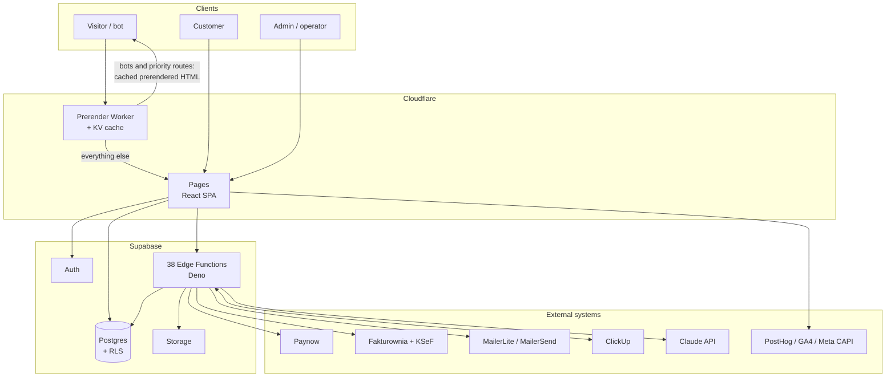

# eskapizm — architecture write-up

[eskapizm.com](https://eskapizm.com) is a travel planning platform: a public site, an acquisition funnel, checkout with payments, an interactive trip app the client uses during the trip, an admin panel, a CMS, an affiliate system, and an AI layer that helps build the plans.

I designed and built it, and I co-run the company behind it. This repository is the part of that work I can share publicly — the architecture, the decisions, and why they went the way they did. The application code stays private; it's a company asset and it handles payments and customer data.

**Scale, as of August 2026:** 3,566 commits · ~65k LOC TypeScript/TSX across 257 source files · 38 Edge Functions in production · 109 database migrations · 114 unit tests on the AI layer alone.

**Timeline:** first commit September 2025. Single developer.

---

## Constraints that shaped everything

Most of the interesting decisions here come from constraints rather than preferences:

- **One developer.** Anything requiring a team to operate was off the table. That ruled out a separately deployed backend, a Kubernetes story, and most microservice patterns.
- **Near-zero infrastructure budget.** The platform had to run on free and near-free tiers while the business was pre-revenue. This is the reason for several decisions below, including one I got wrong the first time.
- **SEO mattered commercially.** Organic traffic is the top of the funnel, so a client-rendered SPA that search engines see as an empty div was not acceptable.
- **The team is non-technical.** My co-founder runs marketing and operations. Anything she needs to do daily had to have a UI, not a CLI or a SQL console.

---

## System overview

The shape is deliberately boring: a static frontend on a CDN, a managed Postgres with row-level security as the actual authorization layer, and serverless functions for everything that needs a secret or must not be trusted to the client. There is no server to patch.

---

## Where the complexity actually is

Three areas carry most of the difficulty.

### 1. The AI planning layer

The interesting problem was not "call a model and show the text". It was letting an operator edit a large structured document through conversation without the model quietly destroying work.

The model does not emit the plan as free text. It calls **29 typed tools** — `add_day`, `modify_accommodation`, `group_accommodations`, `reorder_days`, `update_budget_item`, and so on — each one a narrow, validated mutation against the plan structure. Every call comes back with an explicit outcome so the frontend knows whether anything actually changed. The plan is committed server-side before the UI is told to update, so a dropped connection cannot leave the two out of sync.

That layer alone has 114 unit tests, because this is exactly the kind of code where a regression is invisible until a customer's itinerary is missing a week.

→ [ADR 3: structured tools instead of free-text generation](docs/adr/0003-structured-tools-for-the-ai-agent.md)
→ [ADR 4: an explicit state contract for mutations](docs/adr/0004-explicit-state-contract-for-mutations.md)

### 2. Making a SPA visible to search engines and to AI

A Cloudflare Worker sits in front of the site. It detects crawlers and serves them a prerendered HTML snapshot from KV, rendered on demand through the Browser Rendering API and cached for 24 hours. Human visitors get the SPA, except on priority routes where they also get the cached HTML because it's simply faster.

The bot list includes the AI crawlers — `gptbot`, `perplexitybot`, `claudebot`, `google-extended`, `anthropic-ai`, `meta-externalagent` — which is the practical half of what people now call GEO. If a model can't read the page, it can't cite the brand.

→ [ADR 1: SPA with worker prerendering instead of SSR](docs/adr/0001-spa-with-worker-prerender.md)

### 3. Integrations that have to be right

Payments, invoicing, e-invoicing under the Polish KSeF regime, transactional email, affiliate attribution and commission approval. These are the parts where a bug is not a bad user experience, it's a financial or legal problem. They run in Edge Functions, never in the browser, and the ones that mutate money are idempotent and reconcile against the provider rather than trusting a single webhook delivery.

---

## Data model

The domain splits into six areas: identity and access, commerce, the travel plan itself, the AI session, content, and operations. The plan is the centre of gravity — everything else either produces it, sells it, or delivers it.

→ [Data model and ERD](docs/data-model.md)

---

## Security posture

Authorization lives in Postgres, not in the frontend. Row-level security is the enforcement point; the client holds an anon key that can do almost nothing on its own. Anything privileged happens in an Edge Function with a service role that never leaves the server.

Two things I'd call out because they came from real findings rather than theory:

- A temporary backup table created during a migration was left readable. Caught in Supabase's Security Advisor, fixed by enabling RLS and revoking grants. The lesson I took was that migration by-products need the same review as tables you designed on purpose.
- A broader hardening pass revoked `anon` grants on sensitive tables, replaced public Storage listings with admin-only ones, and pulled trigger helper functions out of the Data API — verified afterwards by confirming a live customer plan rendered byte-for-byte identically.

I'm deliberately not publishing the policy definitions themselves. This is a live platform that takes payments.

---

## What I'd do differently

→ [The honest list](docs/what-id-do-differently.md)

---

## Stack

**Frontend** — React 18, TypeScript, Vite, Tailwind, shadcn/ui, React Query, React Router, Framer Motion, PWA
**Backend** — Supabase: Postgres with RLS, Auth, Storage, Deno Edge Functions
**Edge and hosting** — Cloudflare Pages, Workers, KV, Browser Rendering API
**Integrations** — Paynow, Fakturownia, KSeF, MailerLite, MailerSend, ClickUp, PostHog, GA4, Meta CAPI
**AI** — Claude via API, with a typed tool layer
**Delivery** — GitHub Actions, migrations under review, smoke checks against production after deploy

---

## About the code

The application repository is private. If you're evaluating me and want to read real code rather than a description of it, ask and I'll grant read access.

**Kacper Mioduszewski** · [mioduszewsky.com](https://mioduszewsky.com) · [LinkedIn](https://www.linkedin.com/in/kacper-mioduszewski/) · kacper@mioduszewsky.com
