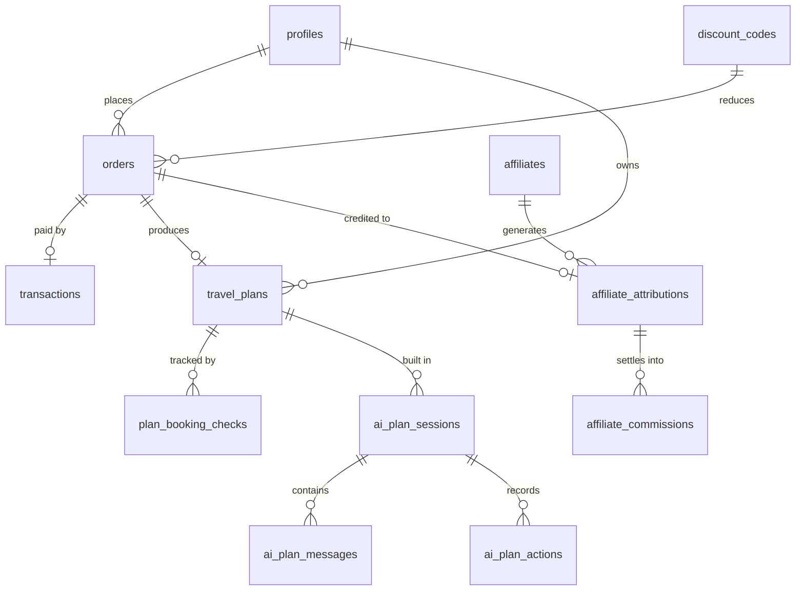
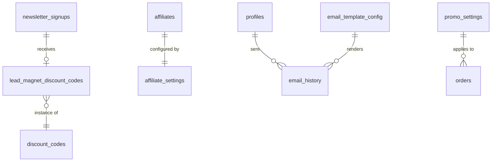
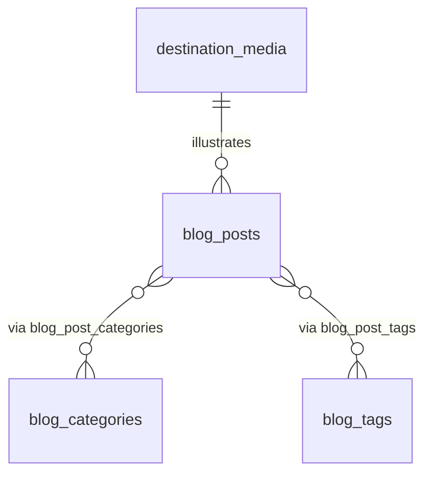
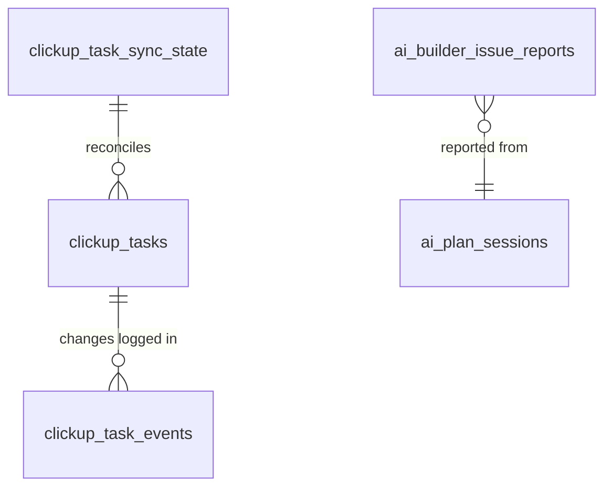

# Data model

33 tables across 116 migrations. They group into six domains. The travel plan is the centre. Everything else either sells it, produces it, or delivers it.

This describes structure and relationships. Column definitions and row-level security policies are not published; the platform is live and takes payments.

## Core: from visitor to delivered plan

**`travel_plans`** holds the plan as a structured document. It is the product the customer pays for.

**`plan_booking_checks`** is what turns a document into something usable on a trip. The customer ticks off transfers and attractions as they book them, and that state persists rather than living in the browser.

**`ai_plan_actions`** is the audit trail from ADR 4. Every committed mutation gets a row, which is what makes "did that edit actually happen" an answerable question rather than a guess.

## Growth and commerce

The lead magnet issues a personal, single-use, time-limited discount code at signup rather than a shared campaign code. That design came from a constraint, the free email tier allows one automation, and it turned out better than what it replaced, because a per-recipient code with an expiry is measurable in a way a shared code is not.

## Content

A custom CMS rather than a headless service. The deciding factor was that content had to be prerenderable by the Worker in ADR 1 and editable by a non-technical co-founder in the same admin panel she already used for orders.

## Operations

ClickUp stays the source of truth for tasks; these tables are a mirror so the team can work in one panel instead of two. The mirror reconciles per list and only after a successful fetch, so an API hiccup cannot empty the board. An earlier version upserted without deleting and left "ghost" tasks that had been removed upstream.

`ai_builder_issue_reports` and `platform_issue_reports` feed one unified issue queue in the admin panel. Bug reports come from the person who hit the bug, in context, with the session attached.

## Compliance and safety

`consent_events` records cookie and tracking consent, which gates analytics and the Meta pixel. `rate_limit_events` backs server-side rate limiting on the expensive endpoints, the AI ones, because a limit enforced in the client is not a limit.

## Notes on modelling choices

**The plan is a document, not a normalised graph.** Days, accommodations, transfers, and activities live inside a structured document rather than as separate tables. This is unusual and deliberate: a plan is authored, versioned, and rendered as a whole, and it is never queried across customers. Normalising it would have bought query flexibility nobody needs and cost the atomic edits ADR 3 depends on.

**Money is append-only where it can be.** Transactions, attributions, and commissions record events rather than being mutated in place, so a reconciliation can always be recomputed from history instead of trusted from a current value.
